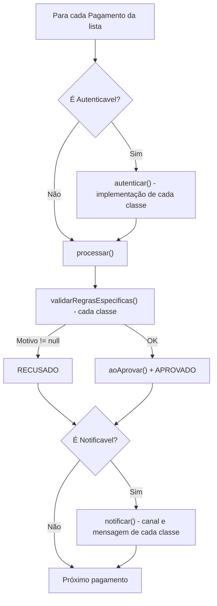

# Relatório — Sistema de Processamento de Pagamentos

**Disciplina:** Programação Orientada a Objetos
**Linguagem:** Java (compatível com Java 11+)

**Integrantes:**
- Lucca Silva Oliveira
- Gustavo Lange do Nascimento
- Guilherme Agnes
- Pedro Henrique Marciniak

---

## 1. Visão geral

O sistema processa pagamentos de clientes em quatro modalidades — **Cartão de Crédito**, **PIX**, **Boleto** e **Carteira Digital** — tratando todas de forma uniforme através de uma classe abstrata (`Pagamento`) e duas interfaces (`Autenticavel` e `Notificavel`).

### Estrutura do projeto

```
src/pagamentos/
├── Main.java                         -> programa principal (só cria e dispara)
├── interfaces/
│   ├── Autenticavel.java             -> contrato de autenticação
│   └── Notificavel.java              -> contrato de notificação
├── modelo/
│   ├── Pagamento.java                -> CLASSE ABSTRATA
│   ├── CartaoCredito.java            -> concreta
│   ├── Pix.java                      -> concreta
│   ├── Boleto.java                   -> concreta
│   ├── CarteiraDigital.java          -> concreta (novo tipo)
│   ├── Cliente.java
│   ├── StatusPagamento.java          -> enum
│   └── TipoChavePix.java             -> enum
└── servico/
    └── ProcessadorPagamentos.java    -> lógica polimórfica de processamento
```

### Fluxo de processamento



---

## 2. Regras de negócio (cálculo de taxas e processamento)

| Modalidade | Regra de taxa | Regras de processamento |
|---|---|---|
| **Cartão de Crédito** | **2,99%** sobre o valor + **1,49% por parcela adicional** (1x = 2,99%; 6x = 10,44%; 12x = 19,38%) | Máximo de 12 parcelas; o valor total precisa caber no **limite disponível**; ao aprovar, o limite é reduzido |
| **PIX** | **Isento** até R\$ 100,00; acima disso **0,99%** com **teto de R\$ 10,00** | Entre **20h e 6h** o valor máximo por transação é **R\$ 1.000,00** (limite noturno do Banco Central); ao aprovar, gera um ID de transação |
| **Boleto** | Tarifa fixa de **R\$ 3,50** + se pago após o vencimento: **multa de 2%** + **juros de 0,033% ao dia** | Linha digitável com **47 dígitos**; não pode estar vencido há **mais de 30 dias** |
| **Carteira Digital** | **1,49%** do valor, com **taxa mínima de R\$ 0,50** | **Saldo** da carteira precisa cobrir o valor total; ao aprovar, o saldo é debitado |

**Exemplos (saída real do programa):**
- Cartão R\$ 1.200,00 em 6x → taxa = 1.200 × (2,99% + 5 × 1,49%) = **R\$ 125,28** → 6x de R\$ 220,88
- PIX R\$ 2.500,00 → 0,99% seria R\$ 24,75, mas o teto limita a **R\$ 10,00**
- Boleto R\$ 800,00 com 10 dias de atraso → 3,50 + 16,00 (multa) + 2,64 (juros) = **R\$ 22,14**
- Carteira R\$ 30,00 → 1,49% seria R\$ 0,45, aplica-se a mínima de **R\$ 0,50**

### Autenticação (cada classe tem a sua)

| Modalidade | Como autentica |
|---|---|
| Cartão de Crédito | Número válido pelo **algoritmo de Luhn**, cartão **dentro da validade** e **CVV** com 3 dígitos |
| PIX | **Formato da chave** compatível com o tipo (CPF = 11 dígitos, CNPJ = 14, e-mail, telefone +55..., chave aleatória UUID) |
| Carteira Digital | **Token de 6 dígitos** informado deve ser igual ao token gerado no dispositivo (2FA) |

### Notificação (cada classe tem a sua)

| Modalidade | Canal | Conteúdo |
|---|---|---|
| Cartão de Crédito | SMS | Aprovação com nº de parcelas e valor da parcela, ou motivo da recusa |
| PIX | E-mail | Comprovante com ID da transação, ou motivo da recusa |
| Boleto | E-mail | Confirmação + prazo de compensação; avisa multa/juros se houve atraso |

---

## 3. Abstração (13.1)

### O que é abstração
Abstração é o processo de **identificar as características essenciais** de um conceito e ignorar os detalhes irrelevantes para o contexto. Em POO, ela permite modelar uma ideia geral ("o que um pagamento é e faz") sem se prender a como cada caso específico funciona.

### Como foi utilizada no sistema
A classe [`Pagamento`](../src/pagamentos/modelo/Pagamento.java) representa a ideia geral de pagamento. Ela reúne:

- **Dados comuns:** `id`, `cliente`, `valor`, `dataCriacao`, `status`, `motivoRecusa`;
- **Comportamentos comuns (concretos):**
  - `processar()` — o fluxo padrão (validar → aprovar ou recusar), igual para todos;
  - `getValorTotal()` — valor + taxa;
  - `exibirResumo()` — monta o resumo com a parte comum e chama a parte específica;
  - `recusar()`, `marcarComoAutenticado()` — controle de status;
- **Comportamentos abstratos (cada filha implementa):**
  - `calcularTaxa()` — regra de taxa;
  - `getTipo()` — nome da modalidade;
  - `validarRegrasEspecificas()` — regras de negócio da modalidade;
  - `getDetalhesEspecificos()` — informações próprias para o resumo.

O método `processar()` segue o padrão **Template Method**: o "esqueleto" do algoritmo é fixo (e `final`, para que nenhuma subclasse o quebre), mas os passos que variam (`validarRegrasEspecificas()` e `aoAprovar()`) são delegados às subclasses.

### Por que uma classe abstrata
- **Não faz sentido existir um "pagamento genérico"**: ninguém paga com "pagamento", paga com cartão, PIX etc. Declarar `abstract` impede `new Pagamento(...)`.
- Precisávamos **compartilhar estado (atributos) e código** entre as modalidades — algo que uma interface não faz (interfaces não têm atributos de instância).
- Precisávamos **obrigar** cada modalidade a definir sua taxa e suas regras: os métodos `abstract` garantem isso em tempo de compilação — se a classe filha esquecer, o código não compila.

---

## 4. Interfaces (13.2)

### O que é uma interface
Uma interface é um **contrato**: define **o que** uma classe sabe fazer (assinaturas de métodos), sem dizer **como**. Uma classe pode implementar várias interfaces, o que permite adicionar **capacidades** a classes de hierarquias diferentes. Enquanto a herança expressa "**é um**" (`Pix` **é um** `Pagamento`), a interface expressa "**é capaz de**" (`Pix` **é capaz de** se autenticar).

### Finalidade das interfaces utilizadas

| Interface | Finalidade |
|---|---|
| [`Autenticavel`](../src/pagamentos/interfaces/Autenticavel.java) | Representa pagamentos que precisam **validar credenciais do pagador antes** do processamento. Método: `autenticar()` |
| [`Notificavel`](../src/pagamentos/interfaces/Notificavel.java) | Representa pagamentos que **enviam mensagem ao cliente** sobre o resultado. Métodos: `gerarMensagemNotificacao()` e `notificar()` |

### Por que algumas classes implementam e outras não

| Classe | Autenticavel | Justificativa | Notificavel | Justificativa |
|---|:---:|---|:---:|---|
| **CartaoCredito** | ✅ | Cartão é alvo frequente de fraude; é preciso confirmar que o número é válido, que o cartão não venceu e que o CVV foi informado | ✅ | O titular precisa ser avisado de cada compra (inclusive para detectar fraude) e do parcelamento |
| **Pix** | ✅ | A transferência é instantânea e **irreversível**; uma chave errada manda dinheiro para a pessoa errada, então a chave é validada antes | ✅ | O cliente precisa do **comprovante** com o ID da transação |
| **Boleto** | ❌ | Boleto é um documento de cobrança que **qualquer pessoa pode pagar** (inclusive terceiros). Não existe credencial do pagador a validar; a conferência é feita pelo banco na compensação | ✅ | O cliente precisa saber que o pagamento foi registrado, que a compensação leva até 3 dias úteis e se houve multa/juros |
| **CarteiraDigital** | ✅ | Acesso a saldo em conta exige **autenticação em dois fatores** (token do dispositivo) | ❌ | O **próprio app da carteira** (PicPay, Mercado Pago...) já envia push a cada transação; notificar de novo pelo nosso sistema geraria **mensagens duplicadas** |

Isso mostra por que esses comportamentos são **interfaces** e não métodos da classe abstrata: se `autenticar()` estivesse em `Pagamento`, o `Boleto` seria obrigado a implementar uma autenticação que não existe na vida real. Interfaces permitem que **apenas quem precisa** tenha a capacidade.

---

## 5. Herança (13.3)

### Classes que utilizam herança
`CartaoCredito`, `Pix`, `Boleto` e `CarteiraDigital` **herdam** (`extends`) de `Pagamento`.

### Características compartilhadas (herdadas de `Pagamento`)
- **Atributos:** `id` (gerado automaticamente), `cliente`, `valor`, `dataCriacao`, `status`, `motivoRecusa`;
- **Validações do construtor:** cliente obrigatório e valor maior que zero;
- **Métodos:** `processar()`, `getValorTotal()`, `exibirResumo()`, `toString()`, `recusar()`, `marcarComoAutenticado()`, `isAutenticado()`, `formatarMoeda()`, getters.

### Características específicas de cada classe

| Classe | Atributos próprios | Comportamentos próprios |
|---|---|---|
| CartaoCredito | `numeroCartao`, `nomeTitular`, `validade`, `cvv`, `parcelas`, `limiteDisponivel` | Parcelamento (`getValorParcela()`), máscara do número, algoritmo de Luhn, débito do limite |
| Pix | `chave`, `tipoChave`, `horario`, `codigoTransacao` | Validação da chave por tipo, limite noturno, geração do ID de transação |
| Boleto | `linhaDigitavel`, `vencimento`, `dataPagamento` | Cálculo de dias de atraso, multa e juros, formatação da linha digitável |
| CarteiraDigital | `provedor`, `identificadorConta`, `saldo`, `tokenDispositivo`, `tokenInformado` | Validação de token 2FA, taxa mínima, débito de saldo |

### Sobrescrita de métodos (`@Override`)
- Todas as filhas **implementam** os métodos abstratos `getTipo()`, `calcularTaxa()`, `validarRegrasEspecificas()` e `getDetalhesEspecificos()`;
- `CartaoCredito`, `Pix` e `CarteiraDigital` **sobrescrevem** o gancho `aoAprovar()` (que em `Pagamento` não faz nada) para, respectivamente, reduzir o limite, gerar o ID da transação e debitar o saldo. O `Boleto` mantém o comportamento herdado;
- `Pagamento` sobrescreve `toString()` de `Object`.

---

## 6. Polimorfismo (13.4)

### Onde foi utilizado
1. **No [`ProcessadorPagamentos.processarLote()`](../src/pagamentos/servico/ProcessadorPagamentos.java)** — um único `for` percorre uma `List<Pagamento>` contendo objetos de tipos diferentes:
   ```java
   for (Pagamento pagamento : lote) {
       if (pagamento instanceof Autenticavel autenticavel) {
           autenticavel.autenticar();   // Cartão, PIX ou Carteira: cada um do seu jeito
       }
       pagamento.processar();           // regras e taxa do tipo concreto
       System.out.println(pagamento.exibirResumo());
       if (pagamento instanceof Notificavel notificavel) {
           notificavel.notificar();     // SMS ou e-mail, mensagem do tipo concreto
       }
   }
   ```
2. **No relatório final** — `p.calcularTaxa()` e `p.getValorTotal()` são chamados em `Pagamento`, mas executam a regra de cada modalidade.
3. **Dentro da própria classe abstrata** — `processar()` e `exibirResumo()` chamam `validarRegrasEspecificas()`, `getTipo()`, `calcularTaxa()` e `getDetalhesEspecificos()`, que só são resolvidos em tempo de execução.
4. **Polimorfismo por interface** — no `Main`, `demonstrarInterfaces()` monta uma `List<Autenticavel>` (Cartão + PIX + Carteira) e uma `List<Notificavel>` (Cartão + PIX + Boleto) e chama o mesmo método em todos.

### Como tipos diferentes são tratados de maneira uniforme
A variável é declarada com o tipo da **abstração** (`Pagamento`, `Autenticavel`, `Notificavel`), e o código só usa os métodos que esse tipo garante. O processador **nunca** pergunta se o objeto é `CartaoCredito`, `Pix`, `Boleto` ou `CarteiraDigital`.

> **Observação sobre o `instanceof`:** o processador verifica apenas se o objeto **possui uma capacidade** (`Autenticavel`/`Notificavel`), e nunca qual é a **classe concreta**. A verificação não depende de nenhum tipo específico: um novo tipo que implemente `Notificavel` será notificado automaticamente, sem mudar uma linha do processador.

### Como o comportamento específico é executado
Pela **ligação dinâmica (dynamic binding)**: em tempo de execução, a JVM verifica o tipo **real** do objeto e chama a versão sobrescrita daquele tipo. Assim, `pagamento.calcularTaxa()` executa a regra de parcelas se o objeto for um cartão, a regra de teto se for PIX, a multa por atraso se for boleto, e a taxa mínima se for carteira.

---

## 7. Encapsulamento

- **Todos os atributos são `private`**; a maioria é `final` (imutável após a criação);
- **Não existem setters**: o estado só muda por operações com regra de negócio (`processar()`, `autenticar()`);
- O **status** só pode ser alterado pela própria hierarquia, por métodos `protected final` (`recusar()`, `marcarComoAutenticado()`) — o `Main` ou o processador não conseguem forçar um pagamento a ficar "Aprovado";
- `processar()` é `final`: nenhuma subclasse pode pular as validações;
- Os construtores **validam os dados** (valor > 0, parcelas entre 1 e 12, cliente obrigatório...);
- Dados sensíveis são protegidos: o número do cartão só é exibido mascarado (`**** **** **** 1111`) e o CVV/token nunca aparecem na saída;
- `getHistorico()` retorna uma **lista não modificável**;
- Constantes das regras (`TAXA_BASE`, `LIMITE_NOTURNO`, `MULTA_ATRASO`...) são `private static final` dentro de cada classe.

---

## 8. Extensibilidade (13.5)

A **Carteira Digital** foi adicionada **depois** das outras modalidades, e para isso foi necessário apenas:

1. **Criar** a classe `CarteiraDigital extends Pagamento`;
2. **Implementar** os 4 métodos abstratos (o compilador obriga);
3. **Escolher** as interfaces necessárias (`implements Autenticavel`);
4. **Instanciar** os objetos no `Main`.

**Arquivos alterados:** nenhum além do `Main` (só para criar os objetos de demonstração). `Pagamento`, `Autenticavel`, `Notificavel`, `ProcessadorPagamentos`, `CartaoCredito`, `Pix` e `Boleto` **não foram modificados**.

Isso segue o **Princípio Aberto/Fechado (SOLID)**: o sistema é **aberto para extensão** (novas classes) e **fechado para modificação** (o código existente não muda).

### E se surgisse uma nova regra?
| Situação | O que fazer |
|---|---|
| Nova regra de taxa em **uma** modalidade (ex.: PIX passa a cobrar 1%) | Alterar só o `calcularTaxa()` de `Pix`; nada mais muda |
| Nova regra para **todos** os pagamentos (ex.: valor máximo de R\$ 50.000) | Adicionar em `Pagamento.processar()` uma única vez; todas as filhas herdam |
| Nova **capacidade** opcional (ex.: estorno) | Criar uma interface `Estornavel` e implementá-la só nas classes que permitem estorno |
| Novo tipo (ex.: Cartão de Débito, Criptomoeda) | Criar a classe herdando de `Pagamento`, como foi feito com a Carteira Digital |

---

## 9. Execução e resultado

Executar `executar.bat` (Windows) ou:
```bash
javac -encoding UTF-8 -d out src/pagamentos/*.java src/pagamentos/*/*.java
java -cp out pagamentos.Main
```

**Cenários demonstrados (11 pagamentos):**

| # | Tipo | Cenário | Resultado |
|---|---|---|---|
| 1 | Cartão | R\$ 1.200 em 6x, dados válidos | Aprovado — taxa R\$ 125,28 |
| 2 | Cartão | Número inválido (Luhn) | Recusado na autenticação |
| 3 | Cartão | R\$ 3.000 em 12x, limite de R\$ 3.000 | Recusado — limite insuficiente com a taxa |
| 4 | PIX | R\$ 80 às 10h | Aprovado — isento |
| 5 | PIX | R\$ 2.500 às 14h30 | Aprovado — taxa no teto de R\$ 10 |
| 6 | PIX | R\$ 1.500 às 22h15 | Recusado — limite noturno |
| 7 | Boleto | Em dia | Aprovado — R\$ 3,50 de tarifa |
| 8 | Boleto | 10 dias de atraso | Aprovado — tarifa + multa + juros = R\$ 22,14 |
| 9 | Carteira | PicPay, token correto, saldo suficiente | Aprovado — saldo debitado |
| 10 | Carteira | Saldo insuficiente | Recusado — taxa mínima aplicada |
| 11 | Carteira | Token incorreto | Recusado na autenticação |

### Simplificações adotadas
- Valores monetários usam `double` com arredondamento em 2 casas, por simplicidade didática (em produção o ideal seria `BigDecimal`);
- Envio de SMS/e-mail e comunicação com bancos são **simulados** com mensagens no console.

---

## 10. Guia rápido para a apresentação

| Pergunta | Onde mostrar |
|---|---|
| Onde está a abstração? | `Pagamento` (`abstract class` + 4 métodos `abstract`) |
| Onde está a herança? | `extends Pagamento` nas 4 classes concretas |
| Onde estão as interfaces? | Pacote `interfaces`; `implements` em cada classe concreta |
| Onde ocorre o polimorfismo? | `for` do `ProcessadorPagamentos.processarLote()`; `processar()`/`exibirResumo()` em `Pagamento`; `demonstrarInterfaces()` no `Main` |
| Por que o Boleto não é `Autenticavel`? | Qualquer pessoa pode pagar um boleto; não há credencial do pagador |
| Por que a Carteira não é `Notificavel`? | O app do provedor já notifica; evitaria duplicidade |
| Como adicionar um novo tipo? | Criar classe `extends Pagamento`, implementar os abstratos, escolher interfaces — nenhuma outra classe muda |
| E se surgir uma nova regra? | Ver tabela da seção 8 |
| Onde está o encapsulamento? | Atributos `private`/`final`, sem setters, `recusar()` `protected final`, `processar()` `final` |
