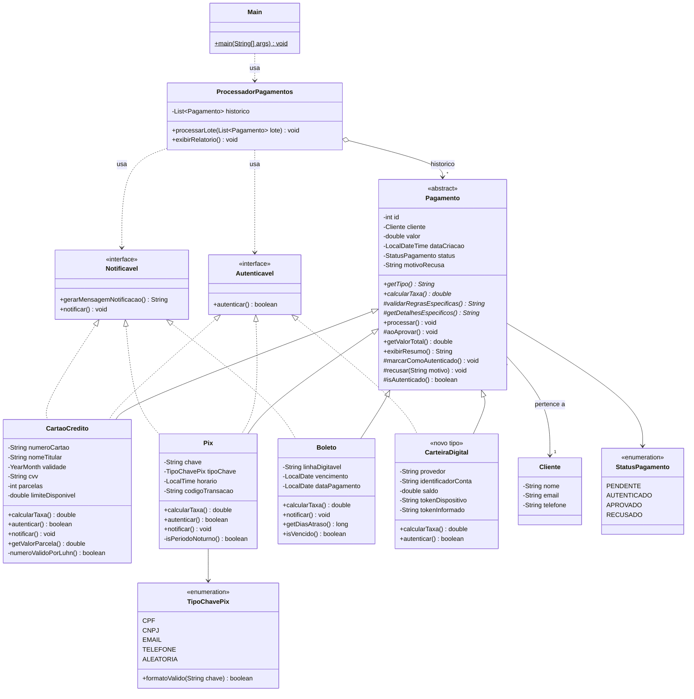

# Diagrama de Classes UML

> Versão Mermaid (renderiza direto no GitHub/VS Code). Versão PlantUML equivalente em [`diagrama-classes.puml`](diagrama-classes.puml) — pode ser exportada como PNG em https://www.plantuml.com/plantuml.

**Legenda de visibilidade:** `+` público · `-` privado · `#` protegido · `*` abstrato · `$` estático

## Resumo dos relacionamentos

| Relacionamento | Tipo UML | Classes |
|---|---|---|
| Herança | Generalização (seta cheia) | `CartaoCredito`, `Pix`, `Boleto`, `CarteiraDigital` → `Pagamento` |
| Implementação | Realização (seta tracejada) | `CartaoCredito`, `Pix`, `CarteiraDigital` → `Autenticavel` |
| Implementação | Realização (seta tracejada) | `CartaoCredito`, `Pix`, `Boleto` → `Notificavel` |
| Associação | `Pagamento` → `Cliente` | Todo pagamento pertence a um cliente |
| Agregação | `ProcessadorPagamentos` ◇→ `Pagamento` | O processador guarda o histórico de pagamentos |
| Dependência | `ProcessadorPagamentos` ⇢ interfaces | Usa as interfaces para autenticar/notificar |

## Matriz de interfaces

| Tipo | Autenticavel | Notificavel |
|---|:---:|:---:|
| Cartão de Crédito | ✅ | ✅ |
| PIX | ✅ | ✅ |
| Boleto | ❌ | ✅ |
| Carteira Digital | ✅ | ❌ |
